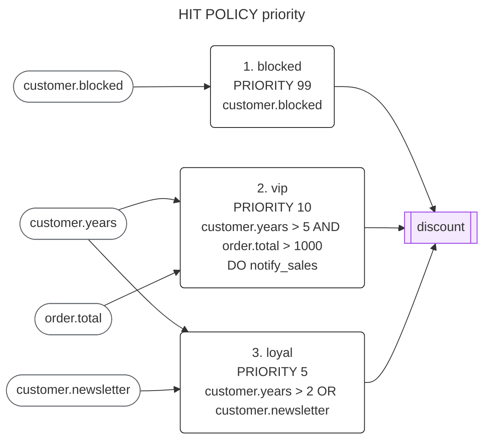
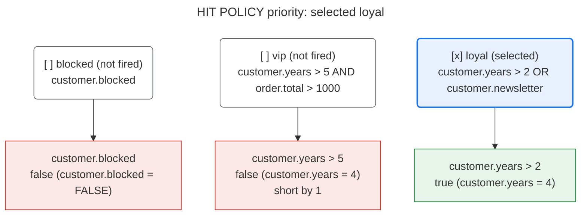

# Diagrams

The core draws conditions, rules, rule sets, explanations and decision tables
as text: DOT for Graphviz, Mermaid for GitHub, GitLab and documentation sites,
and standalone HTML with no script and no external resource
([`spec/visual.md`](../../spec/visual.md)). The same object gives the same
text in every language. The rule set below is
[`discounts.rules`](discounts.rules).

In Rust:

```rust
use cleanrules::explain::{explain, summary};
use cleanrules::json::Limits;
use cleanrules::visual::{DiagramFormat, draw_explanation, draw_ruleset};

let limits = Limits::default();
let rules = cleanrules::text::parse(&std::fs::read_to_string("discounts.rules")?, &limits)?
    .into_ruleset()?;
println!("{}", draw_ruleset(&summary(&rules), DiagramFormat::Mermaid, &limits)?);

let decision = rules.evaluate(&order)?; // years 4, total 1500, not blocked
println!("{}", draw_explanation(&explain(&decision), DiagramFormat::Mermaid, &limits)?);
```

In C, through the C ABI (each text is the caller's, freed with
`cr_string_free`):

```c
char *mermaid = NULL;
if (cr_ruleset_draw(rules, NULL, 0, CR_DIAGRAM_MERMAID, NULL, &mermaid, NULL, &error) == CR_OK) {
    puts(mermaid);
    cr_string_free(mermaid);
}
```

`DiagramFormat::Dot`, `DiagramFormat::Html` and `DiagramFormat::HtmlFragment`
(`CR_DIAGRAM_DOT`, `CR_DIAGRAM_HTML`, `CR_DIAGRAM_HTML_FRAGMENT`) give the
other formats; the bindings draw them from phase V.2.

Mermaid renderers draw at most 50,000 characters (`maxTextSize`) and 500
edges (`maxEdges`) by default, and show an error instead of a larger diagram.
For a large rule set, draw one rule or one decision's explanation, use DOT or
HTML, or raise those settings where your renderer can be configured (GitHub's
cannot). Front-matter titles need Mermaid 10 or later.

## The rule set

Each rule with the fields it reads and the outputs it sets, in the order of
its policy (here, by priority):



## An explanation

The decision for a customer of 4 years with an order of 1500: each rule with
the conditions that decide it, marked true (green) or false (red), how far a
value is from changing the outcome, and the selected rule highlighted:



## A decision table

A decision table is drawn as an HTML grid, with the rows that fired
highlighted when it is given a decision of its rule set
(`draw_table(&table, Some(&decision), DiagramFormat::Html, &limits)`).
